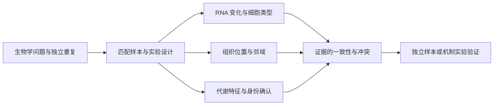

# 06 · 综合项目：把多个分析变成一条可信证据链

## 项目 A：完成一份可复核的学习报告

使用四类入门数据分别回答四个独立问题，不把它们拼成同一个病人/组织的多组学实验。airway、PBMC3k、Visium H&E 和 faahKO 的物种、组织、设计不同，不能按列顺序拼接做跨组学相关。

报告包含：

1. bulk：配对处理对比、QC、候选基因与不确定性。
2. 单细胞：粗谱系注释、marker 证据、未知类别及技术局限。
3. 空间：邻接定义、候选空间模式、置换与多重检验范围。
4. 代谢组：特征差异、缺失/归一化敏感性与鉴定边界。
5. 比较：每种技术测量什么，实验单位是什么，能支持哪类结论。

使用 [分析计划](../templates/analysis_plan.md) 与 [报告模板](../templates/report.md)，每个主要结论链接到实际图表和完整结果表。

## 项目 B：设计真正匹配的多组学研究

提出问题：“某种处理是否改变特定细胞群的代谢状态及其组织位置？”设计之前明确终点：是 RNA 表达、细胞组成、局部富集、代谢物池大小还是通量？不同终点需要不同测量。

规划同一供者/动物的匹配取材，保留 subject、sample、aliquot、时间、组织位置、批次、处理和各模态 QC。无法同时测同一细胞时，写清是在供者级还是组织区级匹配。动物、切片、细胞、spot 和重复进样的层级不得混在一个 n 里。

## 数学层面的连接

相关分析可比较供者级表达摘要 $x_d$ 和代谢量 $m_d$，但共同的 condition、细胞比例或 batch 都可能造成相关。需要清楚的协变量模型与独立重复；把每个供者复制成几千个细胞后做相关会夸大样本量。

潜变量方法可写成 $X^{(v)}\approx ZW^{(v)T}+E^{(v)}$：不同模态 $v$ 共享部分样本因子 $Z$。因子代表共同变化结构，不自动等于通路或因果机制。特征尺度、样本匹配和模态缺失方式会显著影响结果。先学习各模态的测量误差，再按原作者教程选择多组学工具，不为展示“整合图”而强行整合。

如果分组与批次完全混杂，应调整研究设计或限制结论；增加一个整合软件不能恢复缺失的对照。

## 最终评分标准（100 分）

| 项目 | 分值 | 验收内容 |
|---|---:|---|
| 问题和实验单位 | 20 | 组别、重复、配对、协变量、可识别性 |
| 输入和来源 | 15 | 数据 accession/URL、尺度、版本、摘要、样本映射 |
| QC 和方法 | 20 | 有图有理由，参数可追溯，方法适合测量类型 |
| 统计解释 | 20 | 效应、不确定性、多重检验、敏感性、伪重复检查 |
| 生物学解释 | 15 | marker/空间/鉴定证据；明确替代解释 |
| 可复现性 | 10 | 命令、环境、完整表、失败记录和限制 |

把细胞当生物学重复、把未下载数据写成已运行、把 feature 直接写成已鉴定分子，均需先修正再进入评分。

## 与 NGS Analysis Workbench 的衔接

课程借用其分析设计思想：目标 → 已核实材料 → 科学模型 → 证据要求 → 局限。今后执行真实 FASTQ 项目时，再根据实际输入、参考、计算目标和可用工作流规划运行；不能把课程材料中的命令当作已通过运行就绪检查。本次没有云端 run ID，也没有消耗远程分析任务。
